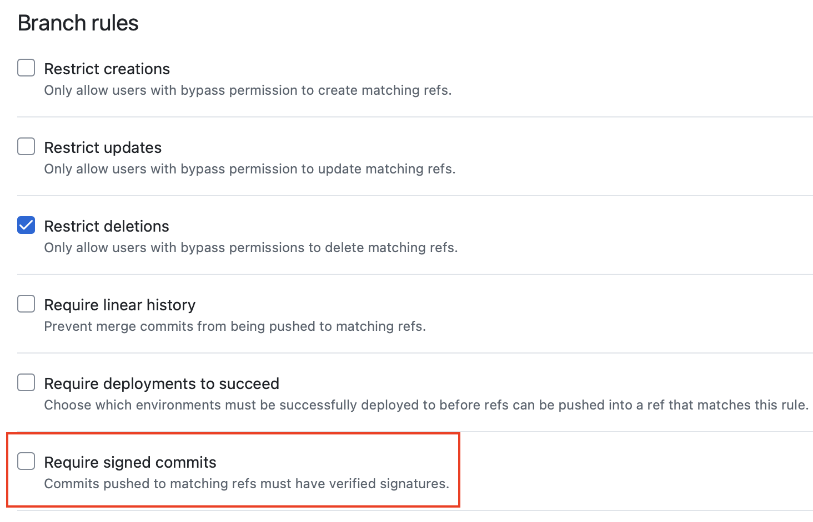

# はじめに
GitHub の branch protection ruleset では、branch を保護するために、コミットへの署名を必須にする設定が可能です。



GitHub Actions で Pull Request を作成する際に次の Actions を利用するとデフォルトではコミットに署名をしません。

https://github.com/marketplace/actions/create-pull-request

# コミットに署名する

冒頭の Actions のコミットに署名するオプションが用意されています。

```
sign-commits
```

`sign-commits` を `true` にすることで `GITHUB_TOKEN` を使って `github-actions[bot]` のコミットに署名します。

変更前は `Unverified` でしたが、変更後は `Verified` となりました。

| before | after|
| - | - |
|  |  |

# おわりに

昨今セキュリティへの観点からコミットへの署名を必須にする設定は推奨されます。
GitHub Actions でのコミットに署名することも可能なので、積極的に branch protection での署名必須を活用していきましょう。

# 関連
- [コミットに署名する](https://zenn.dev/yumemi_inc/articles/signed-commit)
- [コミットに署名するとはどういうことなのか](https://zenn.dev/yumemi_inc/articles/signing-commit-basics)
