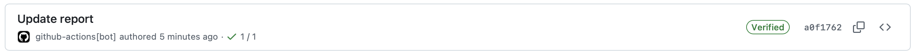

# はじめに
GitHub の Branch protection rulesets では、ブランチを保護するために、コミットへの署名を必須にする設定[^require-signed-commits]が可能です。特に昨今セキュリティの観点からコミットへの署名を必須にする設定は推奨されます。

[^require-signed-commits]: 署名付きコミットを要求する https://docs.github.com/ja/repositories/configuring-branches-and-merges-in-your-repository/managing-rulesets/available-rules-for-rulesets#require-signed-commits


*Branch rules - Require signed commits*

しかし、GitHub Actions で Pull Request を作成する運用を導入している際には注意が必要です。例えば、次の Actions `peter-evans/create-pull-request` を利用しているとデフォルトではコミットに署名をしません。

https://github.com/marketplace/actions/create-pull-request

この記事では、このようなユースケースにおけるコミットへの署名を見ていきます。

# コミットに署名する

冒頭の Actions には、コミットに署名するオプションが用意されています。

`sign-commits` を `true` にすることで `GITHUB_TOKEN` を使って `github-actions[bot]` のコミットに署名します。`token` のオプションを併用することでトークンの指定も可能です[^commit-signature-verification-for-bots]。

```yaml
      - name: Create Pull Request
        uses: peter-evans/create-pull-request@v8
        with:
          sign-commits: true
```

[^commit-signature-verification-for-bots]: Commit signature verification for bots https://github.com/peter-evans/create-pull-request/blob/main/docs/concepts-guidelines.md#commit-signature-verification-for-bots

## sign-commits: false
`sign-commits` は省略可能で、省略した場合はデフォルトの `false` が指定され、署名されません。そのため、GitHub のシステム上で bot のコミットが **Unverified** となります。


*Unverified commit*

## sign-commits: true
`sign-commits` に `true` を指定すると署名され、bot のコミットが **Verified** となります。


*Verified commit*

デフォルトの `token` を利用していない場合は鍵の設定が必要になるため、後述の関連記事を参考にしてください。

# まとめ

GitHub Actions でのコミットに署名することも可能なので、積極的に Branch protection rulesets での署名必須を活用していきましょう。

ただし、このように自動で署名をする仕組みがあると悪用もまた容易になることは懸念としてあります。また署名そのものの意義について過去にリーナスも指摘しています。

> Signing each commit is totally stupid. It just means that you automate it, and you make the signature worth less.[^gpg-signing-for-git-commit]

「各コミットに署名するのは全く愚かなことです。それは単に自動化するだけで、署名の価値を下げてしまうだけです」と言っています。

この設定によって証明できるのは、**GitHub Workflow 上でコミットが作成された**という事実までです。Workflow ファイル自体が改竄されていた場合には気づけないため、自動化しているからこそ、実行環境やワークフローの変更履歴・ステータスを注視しておく必要があります。

[^gpg-signing-for-git-commit]: GPG signing for git commit? https://web.archive.org/web/20210412010515/http://git.661346.n2.nabble.com/GPG-signing-for-git-commit-td2582986.html

## 署名に関する関連記事
https://zenn.dev/yumemi_inc/articles/signed-commit
https://zenn.dev/yumemi_inc/articles/signing-commit-basics
